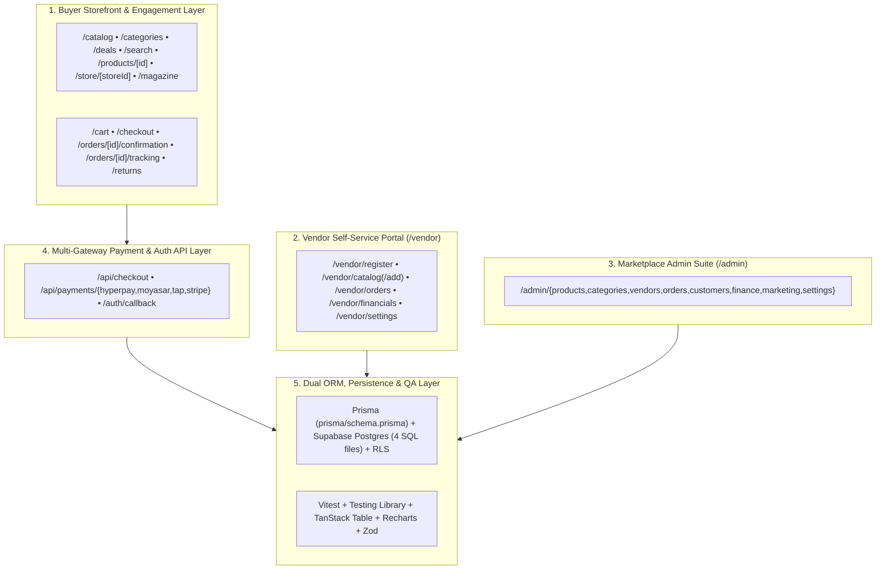
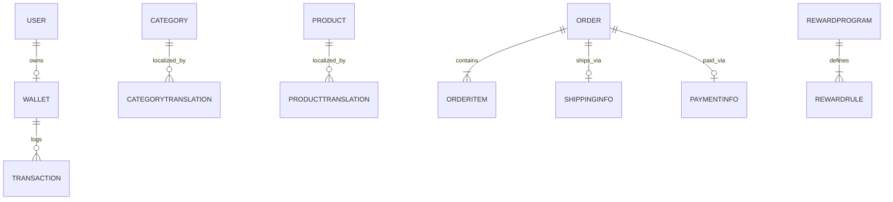

# Shamal El-Hejaz / Souq (`shamalelhejaz`) — Multi-Vendor MENA E-Commerce Marketplace

<p align="center">
  
</p>

## Table of Contents
- [Executive Summary & Business Utility](#executive-summary--business-utility)
- [Visual Showcase (UI & Dashboards)](#visual-showcase-ui--dashboards)
- [System Architecture & Layers](#system-architecture--layers)
- [Data Model & Multi-Gateway Commerce](#data-model--multi-gateway-commerce)
- [Database Schema, Migrations & Prisma](#database-schema-migrations--prisma)
- [Application Modules & API Endpoints](#application-modules--api-endpoints)
- [Getting Started & Scripts](#getting-started--scripts)
- [Business Value, ROI & Growth Opportunities](#business-value-roi--growth-opportunities)

---

## Executive Summary & Business Utility
`shamalelhejaz` (`souq`) is a full-stack Next.js 16, React 19, Prisma, and Supabase **multi-vendor e-commerce marketplace** built for Saudi Arabia and the broader MENA market. It supports multi-merchant storefronts (`/store/[storeId]`), localized categories/products, loyalty wallets & referrals, real-time order tracking (`/orders/[id]/tracking`), dedicated **Vendor** (`/vendor/*`) and **Admin** (`/admin/*`) portals, and **4 integrated payment gateways**: **HyperPay**, **Moyasar**, **Tap**, and **Stripe**.

---

## Visual Showcase (UI & Dashboards)
Brand identity assets in `public/` (plus UI screen specs in `stitch_screens/`):

| Primary Logo | Brand Mark | Square App Icon |
| :---: | :---: | :---: |
|  |  |  |

---

## System Architecture & Layers



| Layer | Responsibility | Key Files |
| :--- | :--- | :--- |
| **Buyer Storefront Layer** | Catalog filtering, deals, vendor storefronts, cart, checkout, order tracking, returns, and policies | `app/{catalog,categories,deals,search,store,cart,checkout,orders,returns,magazine,portals}/` |
| **Vendor Self-Service Layer** | Vendor onboarding, SKU publishing, order fulfillment, and payout reconciliation | `app/vendor/{register,catalog,catalog/add,orders,financials,settings}/page.tsx` |
| **Marketplace Admin Layer** | Platform-wide management of vendors, categories, finance, marketing, and customers | `app/admin/{vendors,products,categories,orders,customers,finance,marketing,settings}/page.tsx` |
| **Multi-Gateway Payment Layer** | Unified checkout endpoint + 4 payment gateway adapters for mada, Apple Pay, STC Pay, and cards | `app/api/checkout/route.ts`, `app/api/payments/{hyperpay,moyasar,tap,stripe}/route.ts` |
| **ORM, Schema & QA Layer** | Prisma relational schema, Supabase production migrations, and Vitest test coverage | `prisma/schema.prisma`, `supabase/migrations/*.sql`, `__tests__/` |

---

## Data Model & Multi-Gateway Commerce


---

## Database Schema, Migrations & Prisma
Combined Prisma (`prisma/schema.prisma`) and Supabase SQL (`supabase/schema.sql` + `supabase/migrations/20261110000001..000002*.sql`):

| Domain | Tables / Models |
| :--- | :--- |
| **Identity & Vendors** | `User`, `public.profiles`, `public.vendors`, `public.addresses`, `Follow` |
| **Localized Catalog & SEO** | `Category`, `CategoryTranslation`, `Product`, `ProductTranslation`, `Image`, `SEOData`, `Review`, `ReviewMedia` |
| **Cart, Orders & Shipping** | `public.cart_items`, `public.wishlists`, `Order`, `OrderItem`, `public.order_items`, `ShippingInfo` |
| **Payments, Wallets & Payouts** | `public.payment_gateways`, `public.payments`, `PaymentInfo`, `public.invoices`, `public.vendor_payouts`, `Wallet`, `Transaction`, `public.wallets`, `public.wallet_transactions` |
| **Growth, Loyalty & Governance** | `RewardProgram`, `RewardRule`, `Referral`, `Coupon`, `Notification`, `public.app_settings`, `public.audit_log` |

---

## Application Modules & API Endpoints

| Endpoint | Purpose |
| :--- | :--- |
| `/api/checkout` | Multi-vendor order creation & checkout orchestration |
| `/api/payments/moyasar` | Moyasar payment processing (mada, Visa/MC, Apple Pay) |
| `/api/payments/hyperpay` | HyperPay payment processing |
| `/api/payments/tap` | Tap Payments gateway integration |
| `/api/payments/stripe` | Stripe international card processing |
| `/auth/callback` | Supabase auth callback handler |

---

## Getting Started & Scripts

```bash
git clone https://github.com/islamsamyy/shamalelhejaz.git
cd shamalelhejaz
npm install
npm run dev
```

| Script | Command | Description |
| :--- | :--- | :--- |
| Dev | `npm run dev` | Start Next.js 16 dev server |
| Build | `npm run build` | Production build (`next build --webpack`) |
| Typecheck | `npm run typecheck` | Run `tsc --noEmit` |
| Lint | `npm run lint` | Run ESLint 9 |
| Test | `npm test` | Run Vitest suite |

---

## Business Value, ROI & Growth Opportunities
- **Zero Single-Gateway Risk**: Supporting HyperPay, Moyasar, Tap, and Stripe simultaneously lets operators route transactions to the lowest-fee or highest-converting regional acquirer.
- **Built-In Retention Engine**: Wallets, reward rules, referral tracking, and coupons reduce reliance on paid ads.
- **B2B / Vendor Subscription + Commission**: Monetize via per-order marketplace commissions (`vendor_payouts`) plus paid vendor marketing placements (`/admin/marketing`).
