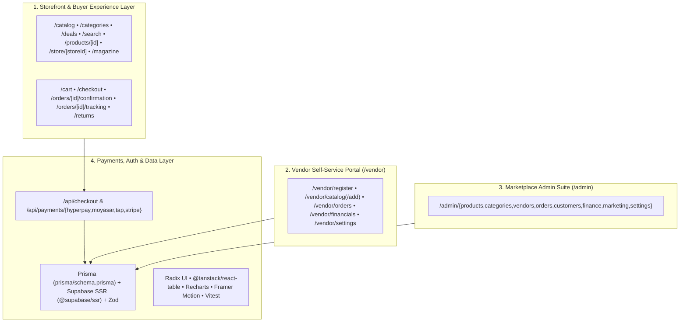

# Shamal El-Hejaz / Souq (`shamalelhejaz`) — Multi-Vendor E-Commerce Marketplace

A full-stack Next.js 16 (`souq`), React 19, Prisma, and Supabase multi-vendor e-commerce marketplace featuring multi-gateway payment processing (**HyperPay**, **Moyasar**, **Tap**, and **Stripe**), dedicated Vendor and Admin portals, real-time order tracking, and Vitest test coverage.

---

## 1. Executive Summary & Purpose
`shamalelhejaz` is a complete regional multi-vendor marketplace engineered for Saudi/MENA commerce. Shoppers browse curated catalogs, vendor storefronts (`/store/[storeId]`), deals (`/deals`), and an editorial magazine (`/magazine`), check out via local and international payment gateways, and track deliveries (`/orders/[id]/tracking`). Vendors manage their own catalogs, orders, and financials (`/vendor/*`), while marketplace operators oversee categories, vendors, finance, and marketing from `/admin/*`.

---

## 2. System Architecture & Layers



| Layer | Responsibility | Key Modules |
| :--- | :--- | :--- |
| **Buyer Storefront Layer** | Product discovery, vendor stores, deals, cart, checkout, order tracking, returns, and policies | `app/{catalog,categories,deals,search,store,cart,checkout,orders,returns,magazine}/` |
| **Vendor Portal Layer** | Multi-vendor onboarding, SKU catalog creation, order fulfillment, and payout financials | `app/vendor/{register,catalog,catalog/add,orders,financials,settings}/page.tsx` |
| **Marketplace Admin Layer** | Platform-wide governance across vendors, customers, orders, finance, and marketing | `app/admin/{vendors,products,categories,orders,customers,finance,marketing,settings}/page.tsx` |
| **Multi-Gateway Payment Layer** | Server-side checkout and regional MENA + global gateway adapters | `app/api/checkout/route.ts`, `app/api/payments/{hyperpay,moyasar,tap,stripe}/route.ts` |
| **Data, ORM & QA Layer** | Prisma ORM schema + Supabase Auth/Postgres + React Hook Form/Zod + Vitest | `prisma/schema.prisma`, `supabase/`, `lib/`, `__tests__/` |

---

## 3. Core Functionality & Modules
- **4-Gateway Payment Engine (`/api/payments/*`)**: Native routes for **Moyasar**, **HyperPay**, **Tap**, and **Stripe**—supporting mada, Apple Pay, STC Pay, and international cards.
- **Multi-Vendor Operations (`/vendor/*`)**: Vendors self-register (`/vendor/register`), upload products (`/vendor/catalog/add`), fulfill orders (`/vendor/orders`), and reconcile earnings (`/vendor/financials`).
- **Marketplace Governance (`/admin/*`)**: Manage vendor approvals (`/admin/vendors`), financial settlements (`/admin/finance`), promotional campaigns (`/admin/marketing`), and customer support.
- **Post-Purchase Experience**: Dedicated `/orders/[id]/confirmation`, `/orders/[id]/tracking`, and `/returns` workflows plus `/policies/shipping-returns`.

---

## 4. Project Structure
```text
├── app/
│   ├── admin/            # Marketplace admin (vendors, products, finance, marketing, orders, settings)
│   ├── api/
│   │   ├── checkout/     # Order checkout API
│   │   └── payments/     # hyperpay, moyasar, stripe, tap adapters
│   ├── auth/             # login, register, callback
│   ├── vendor/           # Vendor portal (catalog, orders, financials, register, settings)
│   ├── orders/[id]/      # confirmation & tracking
│   └── catalog/, categories/, deals/, store/[storeId]/, cart/, checkout/, magazine/, portals/
├── components/, context/, lib/
├── prisma/schema.prisma  # Relational data model
├── supabase/             # Supabase config & policies
└── __tests__/            # Vitest automated tests
```

---

## 5. Getting Started

```bash
git clone https://github.com/islamsamyy/shamalelhejaz.git
cd shamalelhejaz
npm install
npm run dev
```

| Script | Description |
| :--- | :--- |
| `npm run dev` | Start Next.js 16 dev server |
| `npm run build` | Production build (`next build --webpack`) |
| `npm run typecheck` | TypeScript check (`tsc --noEmit`) |
| `npm run lint` | Run ESLint |
| `npm test` | Run Vitest test suite |

---

## 6. Business Value & Growth Opportunities
- **MENA Multi-Vendor Commission Engine**: Built-in vendor financials + regional payment gateways (HyperPay/Moyasar/Tap) allow immediate marketplace monetization via transaction commissions and featured vendor placements (`/admin/marketing`).
- **Logistics & Fulfillment Webhooks**: Connect `/orders/[id]/tracking` to Aramex, SMSA, or DHL APIs for automated shipping label generation and live courier status updates.
- **B2B Wholesale Tiers**: Extend `/portals` and `/vendor` to support bulk MOQ pricing and VAT invoicing for Saudi B2B procurement.
