# البربوزال التجاري والتنفيذي | Commercial & Business Proposal
## منصة «شمال الحجاز» للتجارة الإلكترونية متعددة التجار (Shamal Al-Hijaz Multi-Vendor Marketplace)

---

## 1. الملخص التنفيذي (Executive Summary)

تُعد منصة **«شمال الحجاز» (Shamal Al-Hijaz)** منظومة تجارة إلكترونية سيادية متكاملة متعددة التجار (Enterprise Multi-Vendor Marketplace)، مصممة خصيصاً لتلبية متطلبات السوق السعودي والخليجي وفق أعلى المعايير الهندسية والتشريعية.

تم بناء المنصة لتجمع بين **فخامة تجربة المستخدم**، **سرعة الأداء الفائقة**، و**الامتثال الكامل للأنظمة السعودية** (هيئة الزكاة والضريبة والجمارك **ZATCA Phase-2**، العنوان الوطني **SPL**، ومبادئ الضمان المالي **SAMA Escrow**)، مع دعم فوري لـ **11 عملة دولية** وبحث عربي ذكي، وثلاث بوابات مترابطة تعمل بتناغم لحظي:
1. **واجهة المتجر للعملاء (B2C Storefront)**
2. **بوابة التجار والموردين (B2B Vendor Portal)**
3. **مركز الرقابة والإدارة المركزية (Enterprise Admin Command Center)**

---

## 2. الفجوة السوقية والحل الاستراتيجي (Market Gap & Strategic Solution)

### التحديات الحالية في السوق:
- **ارتفاع عمولات المنصات التقليدية:** تستقطع المنصات الكبرى عمولات مرتفعة (15%–25%) وتفرض قيوداً على العلامات التجارية المحلية والمصانع.
- **غياب الامتثال التنظيمي المدمج:** معظم القوالب الجاهزة تفتقر للتكامل الفعلي مع الفوترة الإلكترونية (ZATCA)، التحقق من السجل التجاري والرقم الضريبي والآيبان السعودي، والعنوان الوطني (SPL).
- **مخاطر الثقة والمدفوعات:** قلق المشتري من المتاجر غير الموثقة، وتأخر التاجر في تحصيل مستحقاته دون نظام ضمان مالي (Escrow) واضح.
- **ضعف التجربة العربية الحقيقية (RTL):** كثير من المنصات تعاني من أخطاء في المحاذاة العربية والبحث عن الكلمات العربية باختلاف الهمزات والتاء المربوطة.

### كيف تحل «شمال الحجاز» هذه التحديات؟
- **منظومة موحدة جاهزة للإطلاق الفوري:** 3 بوابات متكاملة تغطي دورة التجارة من تسجيل التاجر (KYB) حتى تسليم الشحنة وتحرير الأرباح.
- **ضمان مالي ذكي (SAMA Escrow Ledger):** تُحجز أموال المشتري بأمان حتى تأكيد الاستلام، ثم تُحتسب عمولة المنصة آلياً ويُرحّل صافي الربح لمحفظة التاجر.
- **دعم متعدد العملات واللغات:** تسعير مرن بـ 11 عملة (`SAR`, `USD`, `AED`, `EGP`, `EUR`, `GBP`, `KWD`, `QAR`, `BHD`, `OMR`, `JOD`) مع تبديل فوري بين العربية والإنجليزية (`RTL` / `LTR`).

---

## 3. فوائد النظام الشاملة حسب الأطراف المستفيدة (System Benefits)

### أ. فوائد مالك المنصة والمستثمر (Platform Owner & Investor Benefits)
| الفائدة | الأثر التجاري والتشغيلي |
| :--- | :--- |
| **أصل برمجي مكتمل وجاهز للتشغيل** | تقليص وقت الوصول للسوق (Time-to-Market) وتكلفة التطوير التأسيسية بأكثر من 70%. |
| **تعدد مصادر الدخل (6 قنوات إيراد)** | عدم الاعتماد على العمولة فقط، بل دمج الاشتراكات، الإعلانات، الشحن، والخدمات المالية. |
| **حوكمة ورقابة مركزية (RBAC & KYB)** | اعتماد التجار والمنتجات قبل النشر لحماية سمعة العلامة التجارية ومنع المنتجات المخالفة. |
| **جاهزية الدفع المتعددة** | تكامل برمجي جاهز مع **Moyasar, HyperPay, Tap, Stripe** بالإضافة إلى الدفع عند الاستلام والمحفظة. |
| **امتثال ضريبي وقانوني مدمج** | احتساب تلقائي لضريبة القيمة المضافة 15% وتقارير تسوية مالية جاهزة للتدقيق. |

### ب. فوائد التجار والموردين (Vendor & Supplier Benefits)
| الفائدة | الأثر المباشر للتاجر |
| :--- | :--- |
| **توثيق إلكتروني منظم (8-Step KYB)** | انضمام سلس يتحقق من السجل التجاري، الرقم الضريبي، والآيبان البنكي في خطوات واضحة. |
| **استوديو إدارة الكتالوج والمخزون** | إضافة المنتجات، متابعة المخزون المنخفض، استيراد وتصدير البيانات (`CSV`) بضغطة زر. |
| **إدارة طلبات وبوالص شحن موحدة** | متابعة الطلبات الواردة وتجهيزها للشحن عبر شركات النقل المعتمدة (`SPL`, `SMSA`). |
| **شفافية مالية كاملة** | لوحة أرباح تفصل بين الرصيد المعلق في الضمان والرصيد القابل للتحويل الفوري مع كشوفات ضريبية. |

### ج. فوائد العملاء والمتسوقين (Customer Experience Benefits)
| الفائدة | الأثر على معدل التحويل (Conversion Rate) |
| :--- | :--- |
| **واجهة تسوق فاخرة وسريعة** | تصميم عصري (Bento Grid) يعزز الثقة ويرفع متوسط وقت التصفح وإتمام الشراء. |
| **بحث عربي ذكي وتطبيع لغوي** | العثور على المنتجات بدقة حتى مع اختلاف الهمزات والتاء المربوطة والأخطاء الإملائية الشائعة. |
| **سلة ذكية وكوبونات فورية** | عرض واضح للضريبة، تطبيق كوبونات الخصم، وحماية المشتري عبر حساب الضمان. |
| **إتمام شراء بـ 5 خطوات واضحة** | إدخال العنوان الوطني السعودي (SPL) واختيار الشحن والدفع بسلاسة تامة. |

---

## 4. استعراض النظام الحي (Live System Showcase)

### أولاً: واجهة المتجر للعملاء (B2C Storefront)
| الصفحة الرئيسية وعروض اليوم | كتالوج المنتجات والفلاتر الذكية |
| :---: | :---: |
| 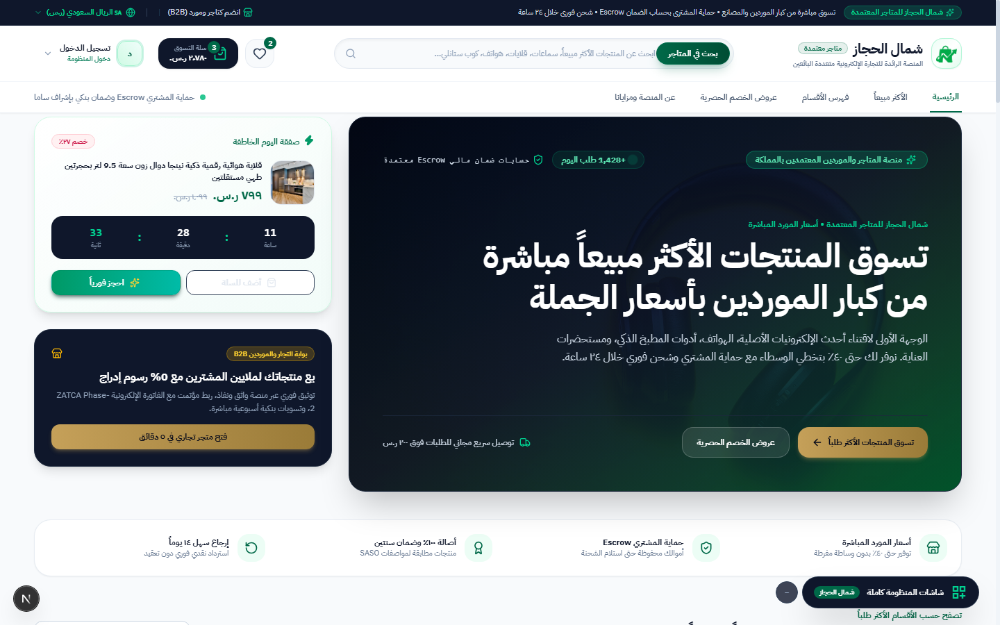 |  |

| صفحة تفاصيل المنتج (PDP) | سلة المشتريات وحساب الضريبة |
| :---: | :---: |
| 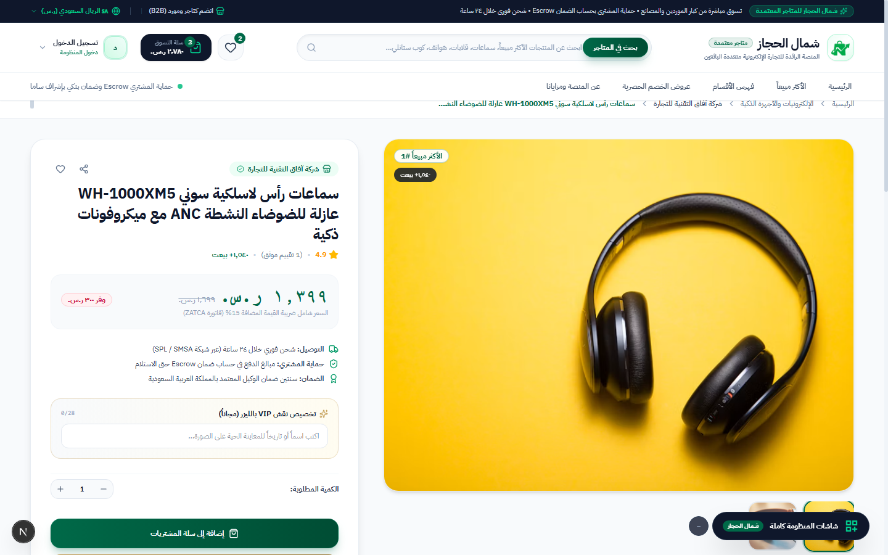 | 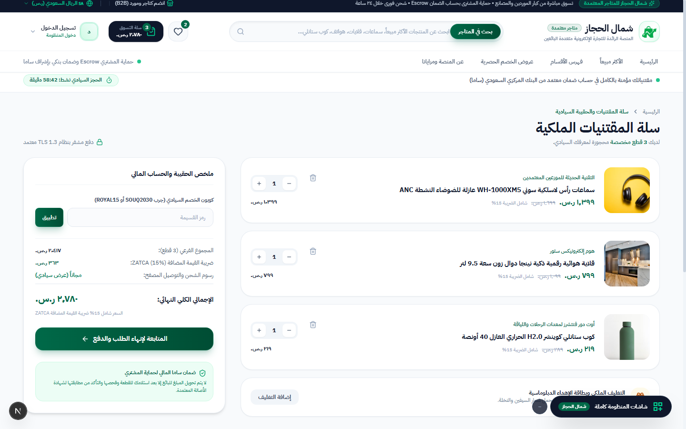 |

| بوابة إتمام الشراء (5 خطوات SPL) | ديوان وحساب العميل |
| :---: | :---: |
| 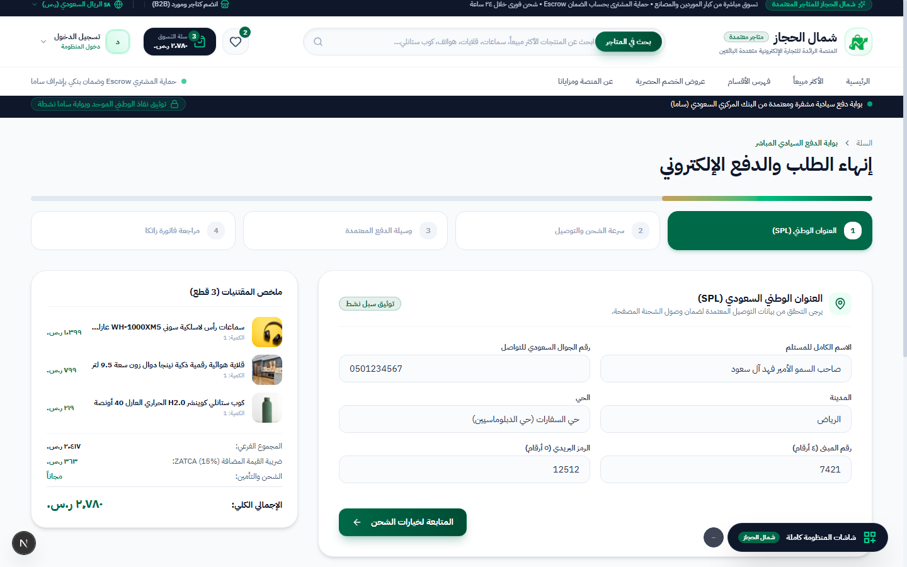 | 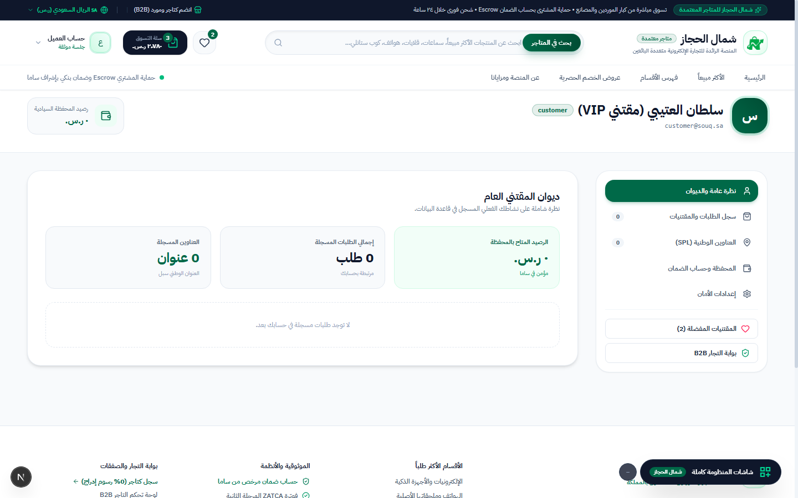 |

### ثانياً: البوابات الموحدة وبوابة التجار (Portals & B2B Vendor Hub)
| مجمّع بوابات المنظومة | بوابة الدخول الموحدة (RBAC) |
| :---: | :---: |
| 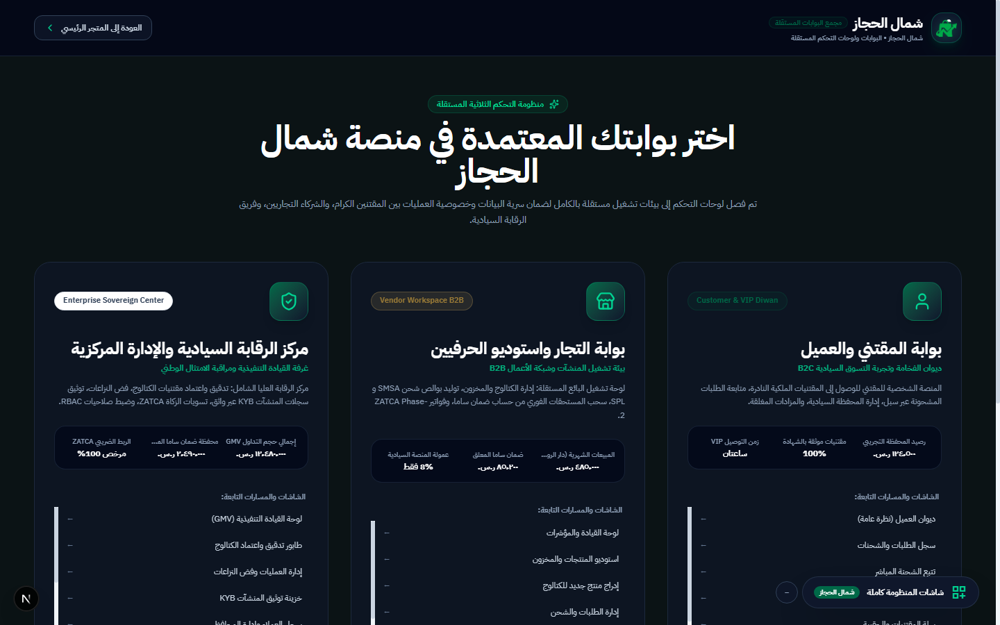 | 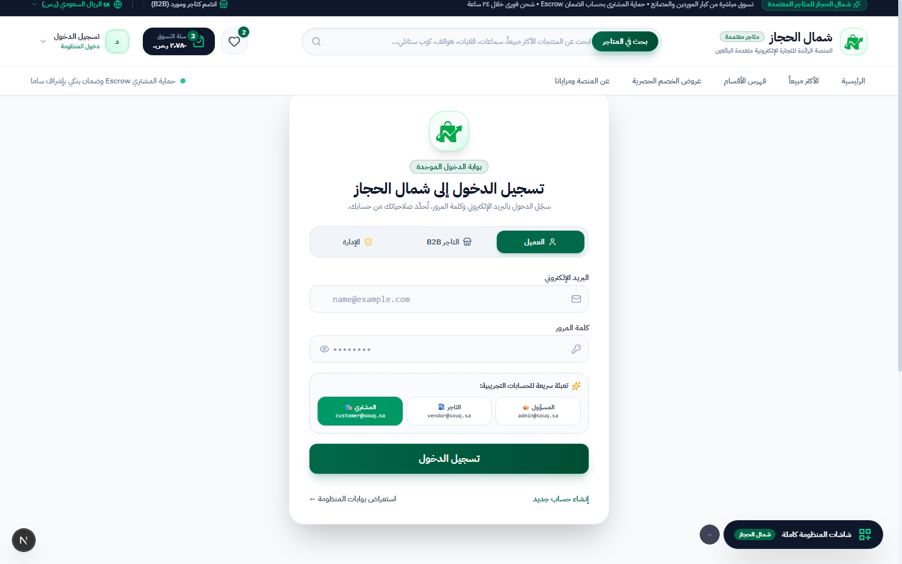 |

| معالج توثيق التاجر (8 خطوات KYB) | لوحة تحكم التاجر والمؤشرات |
| :---: | :---: |
| 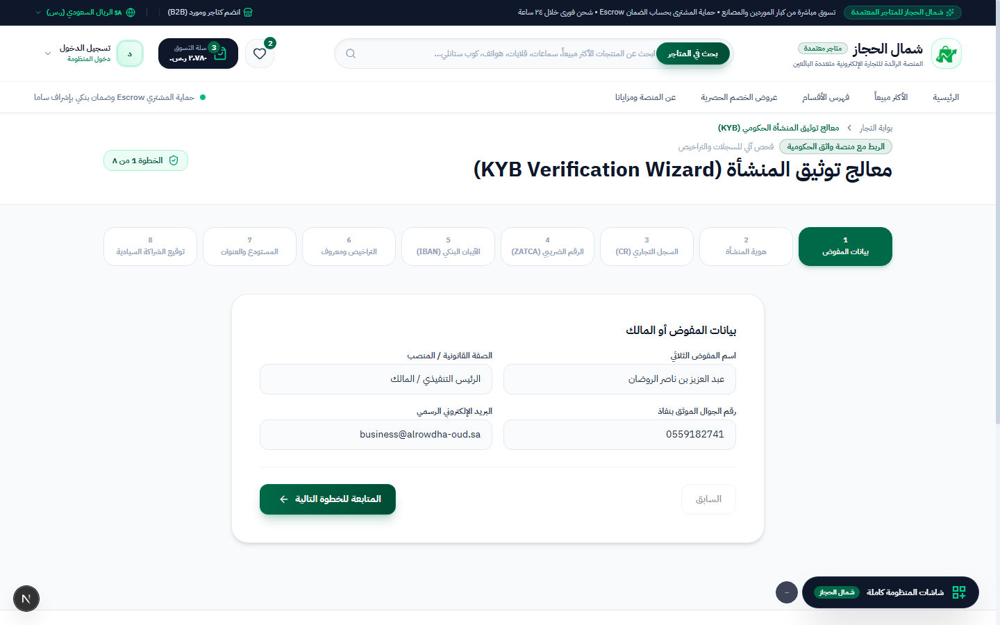 | 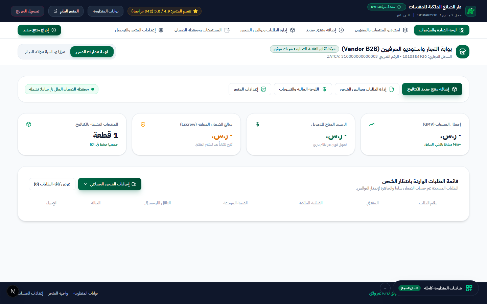 |

| استوديو الكتالوج والمخزون | اللوحة المالية وحساب الضمان للتاجر |
| :---: | :---: |
| 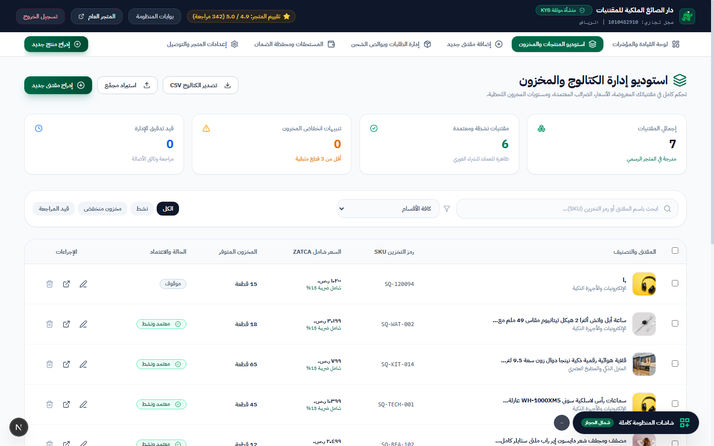 | 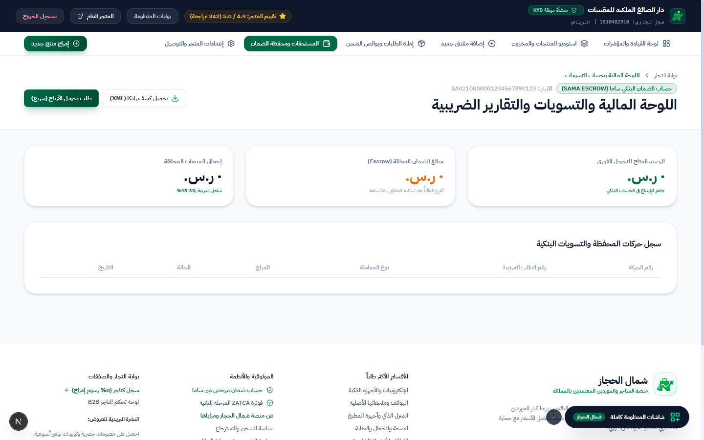 |

### ثالثاً: مركز الرقابة والإدارة المركزية (Enterprise Admin Command Center)
| غرفة القيادة التنفيذية (GMV) | خزينة توثيق المنشآت والعمولات |
| :---: | :---: |
| 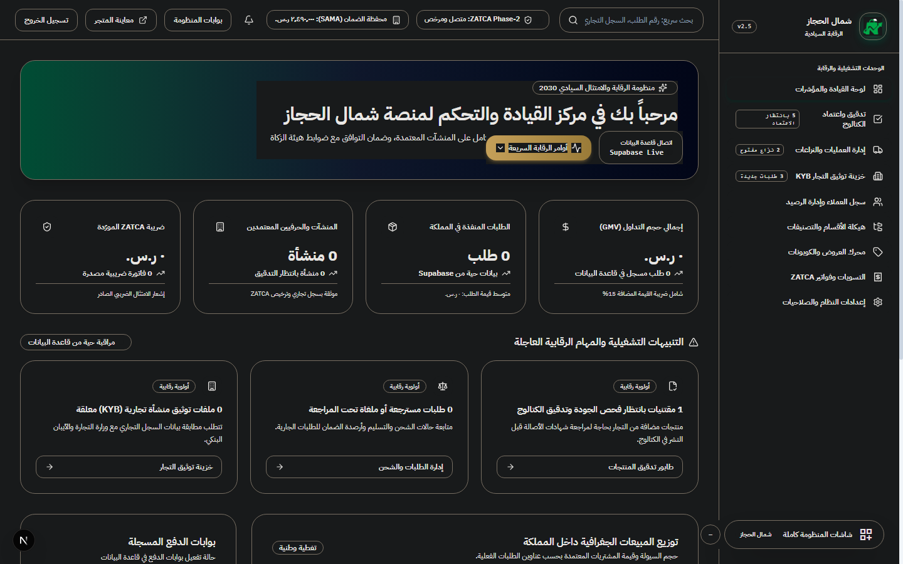 | 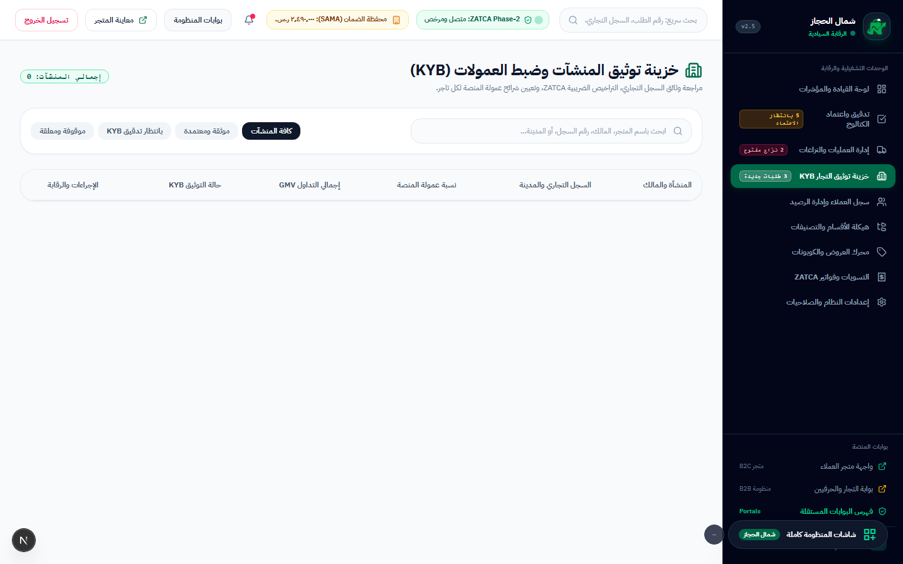 |

| التسويات المالية وضريبة ZATCA |
| :---: |
| 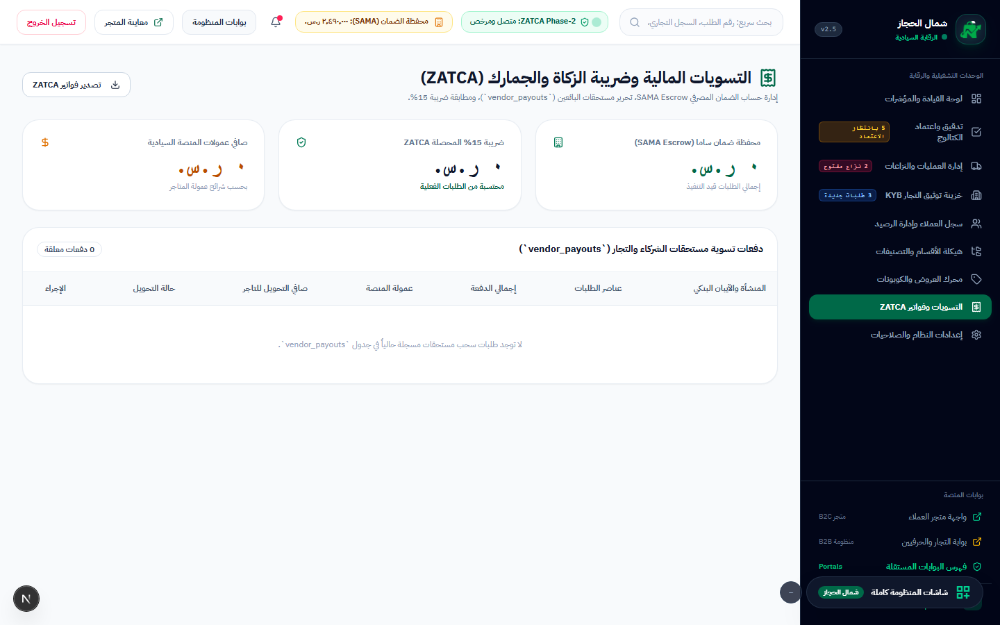 |

---

## 5. نموذج الإيرادات والربحية (Monetization Model)

تولّد المنصة عوائد مستدامة عبر **6 مسارات ربحية متوازية**:
1. **عمولة المبيعات (Commission / Take Rate):** نسبة مرنة (5%–15%) حسب الفئة تُقتطع آلياً عند تحرير الضمان المالي.
2. **باقات اشتراك التجار (Vendor SaaS Tiers):** اشتراكات شهرية/سنوية للباقات المتقدمة (تحليلات موسعة، أولوية دعم، أدوات تسويق).
3. **الإعلانات الممولة (Sponsored Listings & Banners):** ظهور مدفوع لمنتجات التجار في الصفحة الرئيسية وأعلى نتائج البحث.
4. **هامش الخدمات اللوجستية (Logistics Margin):** التعاقد بأسعار الجملة مع شركات الشحن وتقديمها للتاجر بهامش ربح ثابت لكل شحنة.
5. **رسوم التسوية السريعة (Instant Payout Fee):** رسوم اختيارية (1%–2%) للتاجر الراغب في تحويل أرباحه فورياً.
6. **خدمات القيمة المضافة والتمويل (Fintech & BNPL Partnerships):** عوائد شراكات الدفع الآجل وبوابات الدفع.

---

## 6. القوة التقنية والأمان (Technical & Security Highlights)

- **أداء فائق:** مبنية على **Next.js 16** و**React 19** و**Tailwind CSS v4** مع تحسين الخطوط والصور.
- **حماية المسارات والصلاحيات (`proxy.ts` & `lib/rbac.ts`):** التحقق من جلسات Supabase JWT وقراءة الصلاحيات (`admin`, `vendor`, `customer`) من قاعدة البيانات مباشرة دون الوثوق بملفات تعريف الارتباط غير الموثقة.
- **معاملات آمنة (`create_order_secure`):** إنشاء الطلبات في قاعدة البيانات عبر دالة مخزنة ذرية (Atomic RPC) تمنع التلاعب بالأسعار من جهة العميل.

---

## 7. خريطة الإطلاق المقترحة (Go-Live Roadmap)

| المرحلة | المدة المقترحة | المخرجات الرئيسية |
| :--- | :--- | :--- |
| **المرحلة 1: التهيئة والربط الإنتاجي** | الأسبوع 1–2 | تفعيل مفاتيح الإنتاج لبوابات الدفع (Moyasar/HyperPay/Tap)، ربط حسابات الشحن، وإعداد النطاق الرسمي. |
| **المرحلة 2: الإطلاق التجريبي (Soft Launch)** | الأسبوع 3–4 | استقطاب أول 20–50 تاجراً معتمداً، اختبار دورة الطلب والشحن والفاتورة الضريبية فعلياً. |
| **المرحلة 3: التدشين العام والنمو** | الشهر 2–3 | فتح التسجيل العام، إطلاق الحملات التسويقية وكوبونات الافتتاح، وتفعيل الإعلانات الممولة للتجار. |

---

*تم إعداد هذا البربوزال التجاري والوثيقة التنفيذية استناداً إلى النسخة الحية والمفعّلة من منصة **شمال الحجاز (Shamal Al-Hijaz)**.*
