# Shamal Al-Hijaz (شمال الحجاز) — Detailed System Documentation

**Shamal Al-Hijaz (Souq Saudiya)** is an enterprise-grade, multi-vendor e-commerce marketplace engineered for the Kingdom of Saudi Arabia and GCC markets. It unifies a **B2C Customer Storefront**, a **B2B Vendor Operations Portal**, and an **Enterprise Admin Command Center** with full bilingual Arabic/English support (`RTL` / `LTR`), multi-currency conversion, Saudi regulatory compliance (ZATCA Phase-2, SPL National Address, KYB), and SAMA-aligned Escrow accounting.

---

## 1. High-Level Architecture

```
┌──────────────────────────────────────────────────────────────────────────────┐
│                        SHAMAL AL-HIJAZ ECOSYSTEM                             │
├──────────────────────────┬──────────────────────────┬────────────────────────┤
│  1. Customer Storefront  │  2. Vendor Portal (B2B)  │ 3. Enterprise Admin    │
│     (17+ B2C Routes)     │     (7 B2B Routes)       │    (9 Admin Routes)    │
├──────────────────────────┼──────────────────────────┼────────────────────────┤
│ • Bento Discovery Home   │ • 8-Step KYB Wizard      │ • GMV Command Center   │
│ • Smart Arabic Search    │ • Inventory & SKU Studio │ • KYB Verification Vault│
│ • Catalog & Filters      │ • Order & Waybill Hub    │ • Catalog Moderation   │
│ • Product Detail (PDP)   │ • SAMA Escrow Financials │ • Orders & Disputes    │
│ • Multi-Vendor Cart      │ • Storefront Settings    │ • ZATCA & Payouts      │
│ • 5-Step SPL Checkout    │                          │ • Categories & Coupons │
│ • Account & Tracking     │                          │ • RBAC & Settings      │
└──────────────────────────┴──────────────────────────┴────────────────────────┘
                                      │
                                      ▼
┌──────────────────────────────────────────────────────────────────────────────┐
│                 NEXT.JS 16 APP ROUTER + SUPABASE POSTGRESQL                  │
├──────────────────────────────────────────────────────────────────────────────┤
│ • Route Protection: proxy.ts (JWT validation + DB profiles.role check)       │
│ • Checkout RPC: app/api/checkout/route.ts -> create_order_secure             │
│ • Payment Gateways: Moyasar, HyperPay, Tap, Stripe, Wallet, COD              │
│ • Localization & Currency: LanguageContext + CurrencyContext (11 currencies) │
└──────────────────────────────────────────────────────────────────────────────┘
```

---

## 2. Technology Stack

| Layer | Technologies |
| :--- | :--- |
| **Framework & Runtime** | Next.js 16 (`16.4.5`, App Router, Turbopack/Webpack), React 19 (`19.3.0`), TypeScript 5 |
| **Styling & UI** | Tailwind CSS v4 (CSS Logical Properties `ms-*`, `me-*`, `ps-*`, `pe-*` for seamless RTL/LTR), Radix UI Primitives, `shadcn/ui`, Lucide Icons |
| **Motion & Feedback** | Framer Motion, Sonner Toasts, Canvas-Confetti |
| **Data & Forms** | TanStack React Table, React Hook Form, Zod |
| **Backend & Database** | Supabase (`@supabase/supabase-js`, `@supabase/ssr`), PostgreSQL, Prisma ORM |
| **Charts & Visualization** | Recharts |
| **Testing** | Vitest, React Testing Library, Jest DOM |

---

## 3. Complete Application Route Map

### A. Customer Storefront (B2C)
| Route | Description |
| :--- | :--- |
| `/` | Bento-grid luxury homepage with hero, flash deals countdown, featured categories, and vendor onboarding CTA |
| `/catalog` | Dynamic product catalog with smart filtering (category, price range, sort) |
| `/categories` | Full category directory |
| `/deals` | Flash deals & exclusive promotions |
| `/search` | Smart Arabic-normalized search results page |
| `/products/[id]` | High-converting Product Detail Page (PDP) with ZATCA 15% VAT notice, VIP engraving preview, and add-to-cart |
| `/store/[storeId]` | Dedicated brand/vendor storefront page |
| `/cart` | Multi-vendor shopping cart with coupon validation (`SOUQ2030`, `ROYAL15`), VAT breakdown, and SAMA buyer protection |
| `/checkout` | 5-step checkout flow with Saudi Post (SPL) National Address, shipping speed, payment method, and ZATCA invoice review |
| `/orders/[id]/confirmation` | Order confirmation with ZATCA Phase-2 tax invoice details |
| `/orders/[id]/tracking` | Live shipment tracking timeline |
| `/account` | Customer account center (overview, orders, SPL addresses, wallet & escrow, security settings) |
| `/wishlist` | Saved wishlist items |
| `/returns` | Return Merchandise Authorization (RMA) center |
| `/magazine` | Editorial shopping & lifestyle magazine |
| `/about`, `/contact`, `/faq`, `/terms`, `/policies/*` | Trust, legal, and support pages |

### B. Vendor Operations Portal (B2B)
| Route | Description |
| :--- | :--- |
| `/vendor/register` | 8-step KYB (Know Your Business) onboarding wizard (Authorized Person, Entity Identity, CR, ZATCA VAT, IBAN, Licenses, Warehouse, Agreement) |
| `/vendor` | Vendor Operations Hub: GMV, available balance, SAMA Escrow held funds, active SKUs, pending shipments |
| `/vendor/catalog` | Inventory & Catalog Studio with CSV export/import, stock alerts, and moderation status |
| `/vendor/catalog/add` | Add new product form with pricing, VAT, and SKU management |
| `/vendor/orders` | Order fulfillment & SPL/SMSA waybill generation |
| `/vendor/financials` | SAMA Escrow ledger, ZATCA XML export, and fast payout requests |
| `/vendor/settings` | Store profile, shipping, and bank settlement configuration |

### C. Enterprise Admin Command Center
| Route | Description |
| :--- | :--- |
| `/admin` | Executive Command Center: live GMV, orders, verified vendors, ZATCA VAT collected, operational alerts |
| `/admin/vendors` | KYB Verification Vault & vendor commission rate management |
| `/admin/products` | Master catalog moderation & quality approval queue |
| `/admin/orders` | Platform-wide order monitoring & dispute resolution |
| `/admin/finance` | SAMA Escrow oversight, `vendor_payouts` settlement, and ZATCA Phase-2 tax exports |
| `/admin/categories` | Category taxonomy & hierarchy management |
| `/admin/customers` | Customer CRM & wallet oversight |
| `/admin/marketing` | Platform coupons & promotional campaigns |
| `/admin/settings` | RBAC permissions & system governance |

### D. Authentication & Portals
| Route | Description |
| :--- | :--- |
| `/portals` | Unified Ecosystem Portal Selector (Customer, Vendor B2B, Enterprise Admin) |
| `/auth/login` | Unified role-aware login with 1-click demo accounts (`admin@souq.sa`, `vendor@souq.sa`, `customer@souq.sa`) |
| `/auth/register` | Customer & account registration |

---

## 4. Visual System Walkthrough

### Storefront & Discovery
| Home (Bento Hero & Flash Deals) | Product Catalog & Smart Filters |
| :---: | :---: |
| 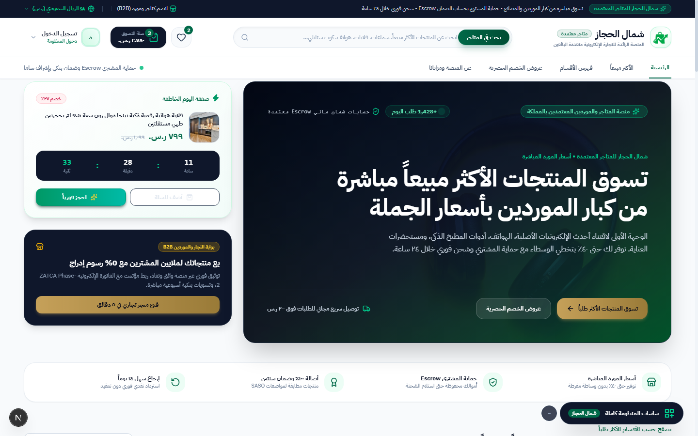 | 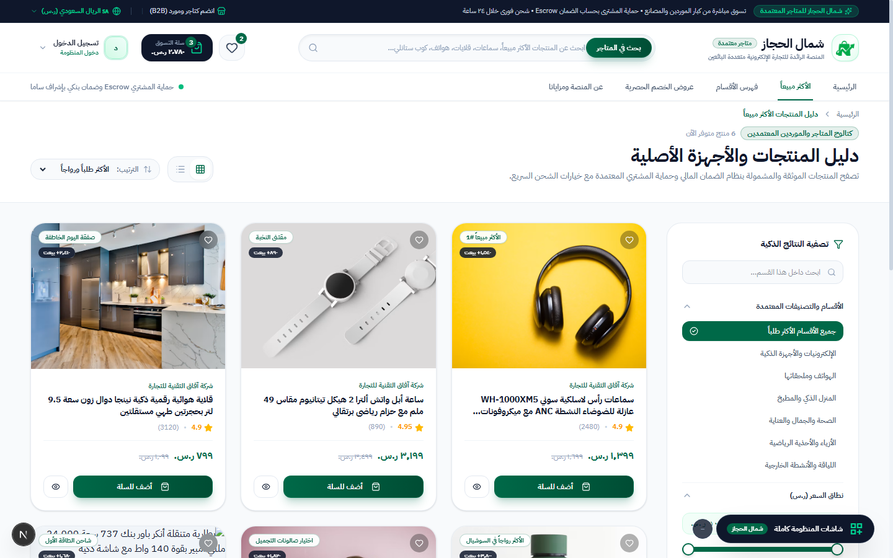 |

| Product Detail Page (PDP) | Multi-Vendor Shopping Cart |
| :---: | :---: |
| 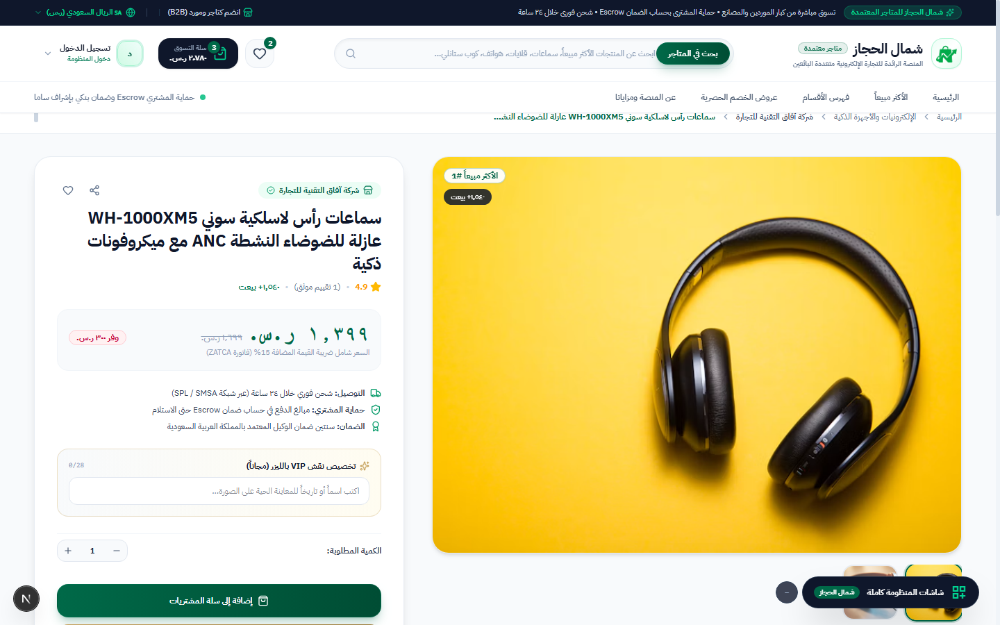 | 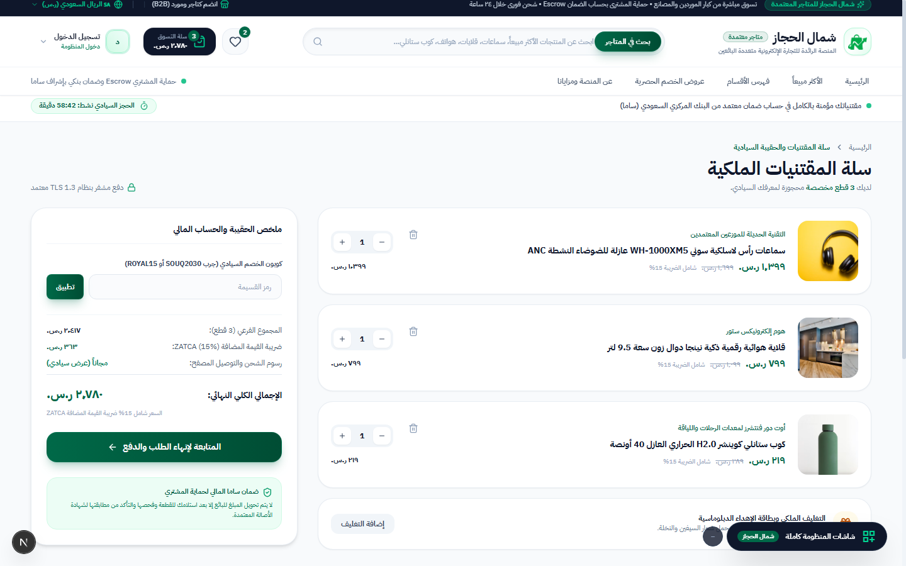 |

| 5-Step SPL Checkout | Customer Account Center |
| :---: | :---: |
| 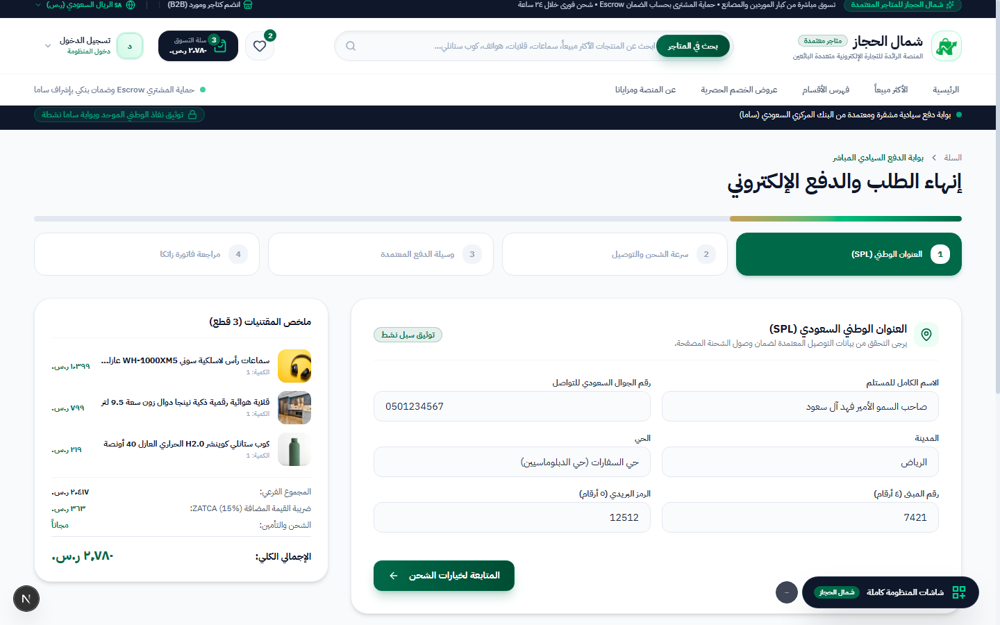 | 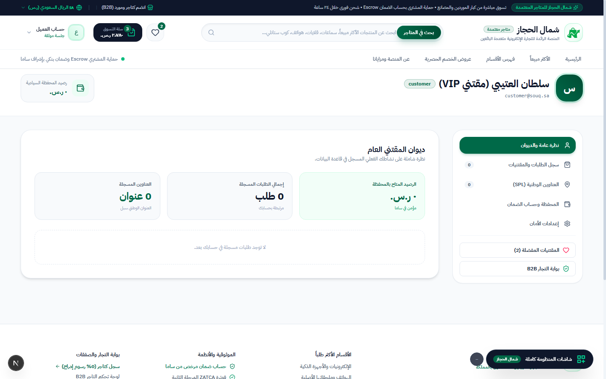 |

### Portals & Authentication
| Ecosystem Portals Hub | Unified Role-Aware Login |
| :---: | :---: |
| 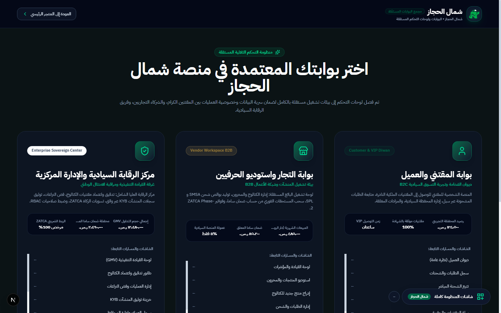 | 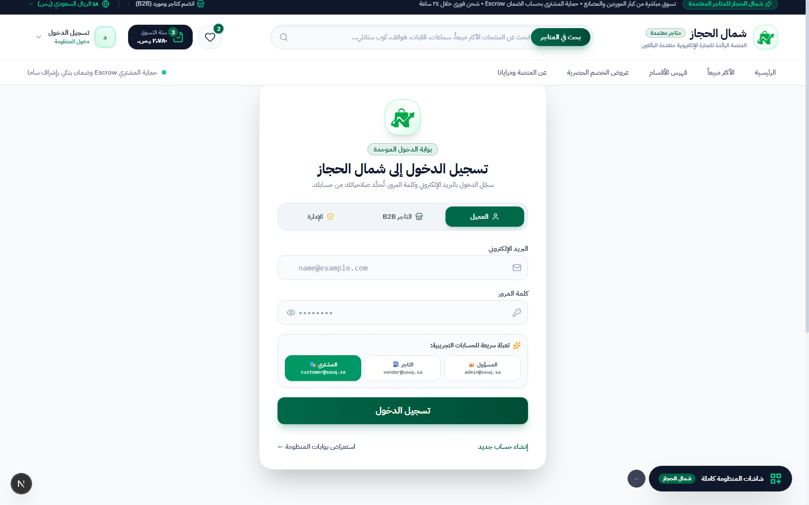 |

### Vendor Operations Portal (B2B)
| 8-Step KYB Registration Wizard | Vendor Hub & KPIs |
| :---: | :---: |
| 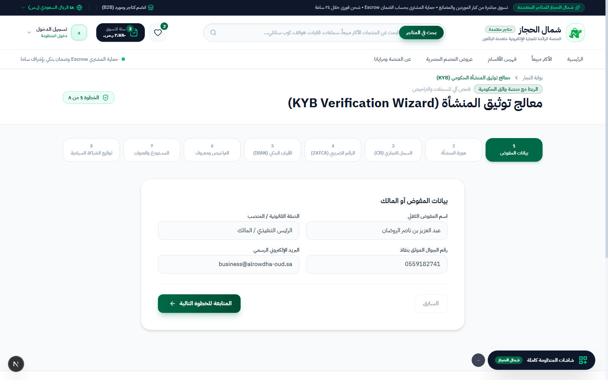 | 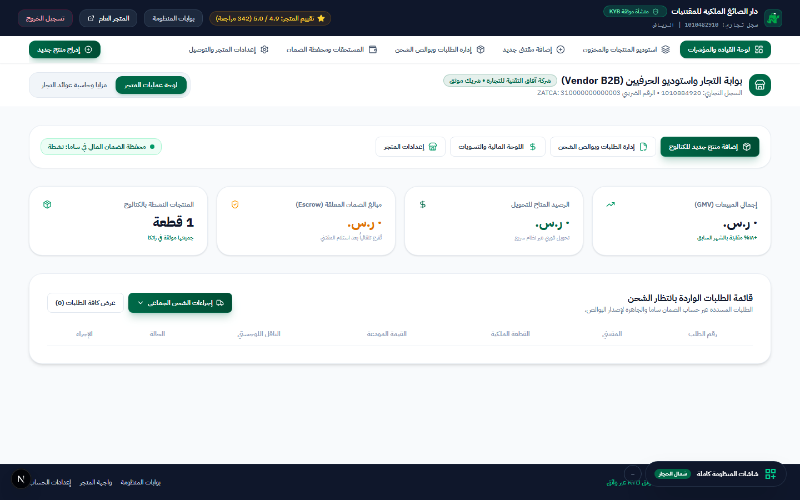 |

| Vendor Catalog Studio | Vendor Financials & SAMA Escrow |
| :---: | :---: |
| 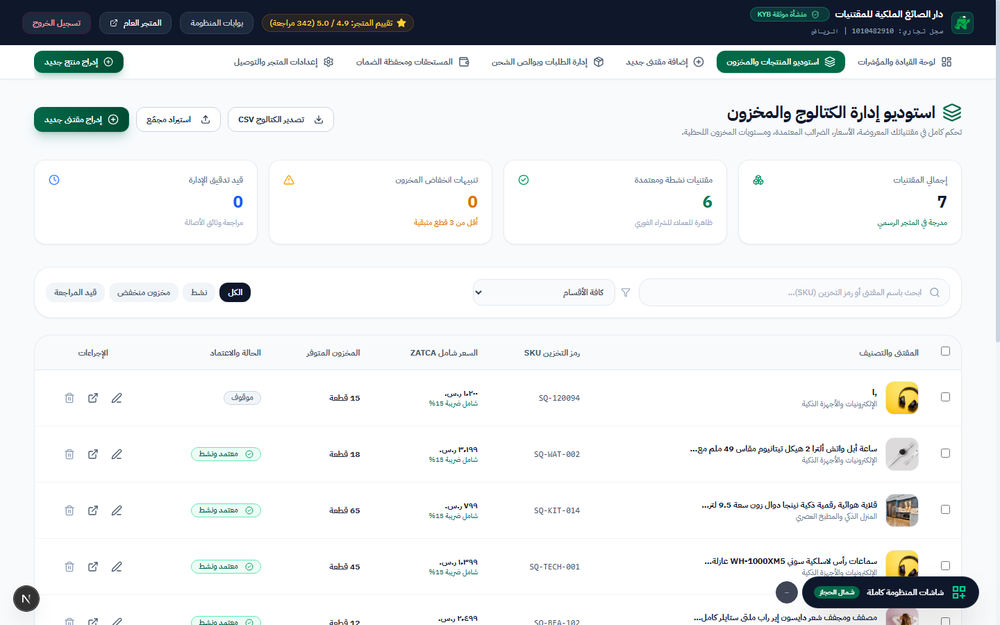 | 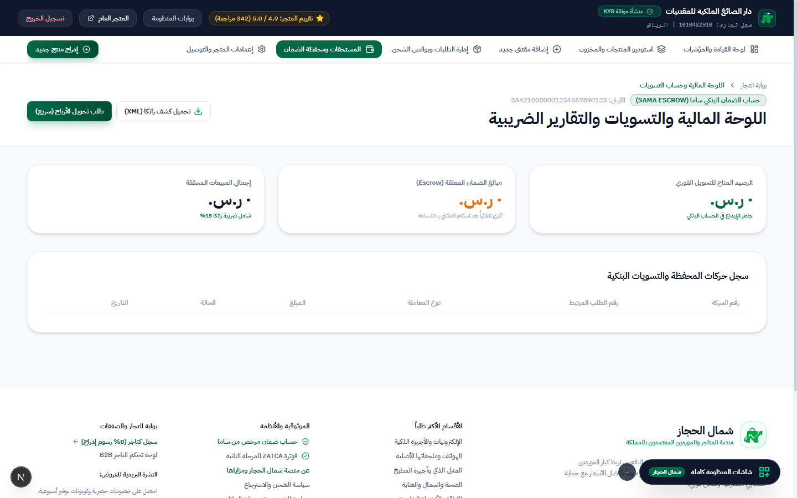 |

### Enterprise Admin Command Center
| Admin Executive Dashboard | Admin KYB Verification Vault |
| :---: | :---: |
| 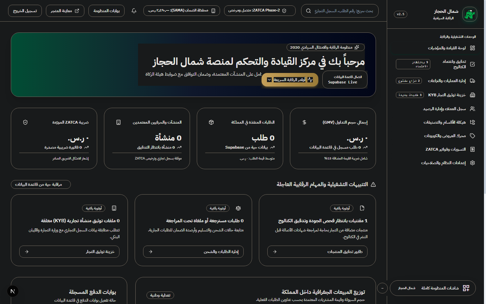 | 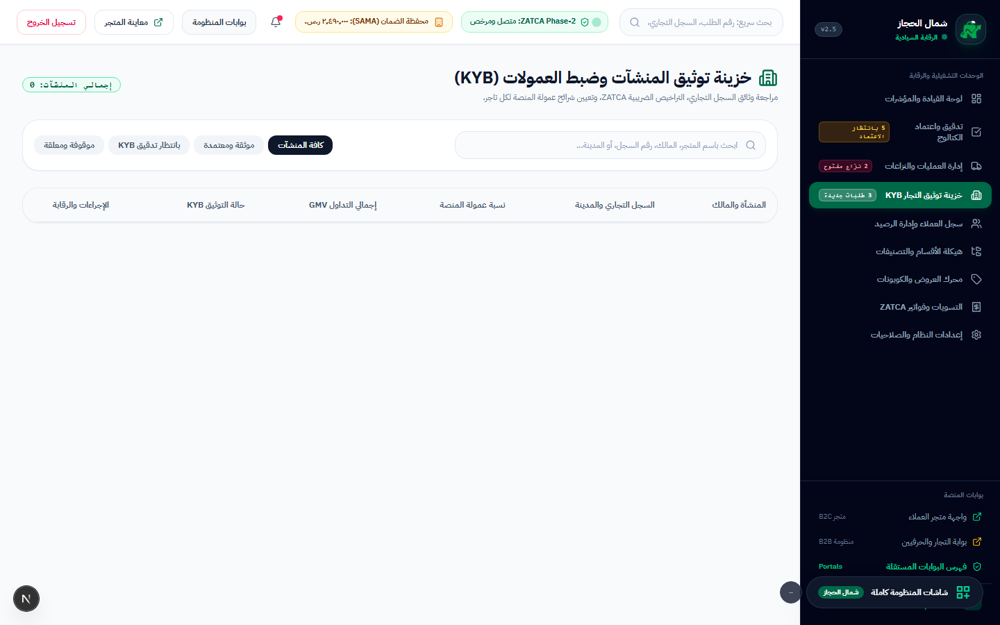 |

| Admin Finance & ZATCA Settlements |
| :---: |
| 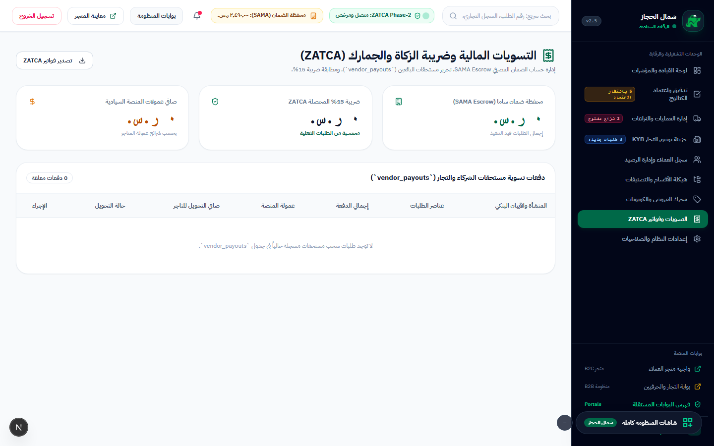 |

---

## 5. Backend APIs & Core Modules

### API Route Handlers (`app/api/`)
- **`POST /api/checkout`** (`app/api/checkout/route.ts`): Authenticates the session user via `getSessionUser()`, validates cart items and SPL address fields, executes the atomic PostgreSQL RPC `create_order_secure`, and returns the created order summary.
- **Payment Gateway Handlers**:
  - `app/api/payments/moyasar/route.ts` — Moyasar (Mada, Apple Pay, STC Pay, Visa/Mastercard)
  - `app/api/payments/hyperpay/route.ts` — HyperPay enterprise gateway
  - `app/api/payments/tap/route.ts` — Tap Payments GCC integration
  - `app/api/payments/stripe/route.ts` — Stripe international cards

### Core Utility Engines (`lib/`)
1. **Multi-Currency Preview Engine (`lib/currency.ts` & `context/CurrencyContext.tsx`)**:
   - Base currency: `SAR` (Saudi Riyal).
   - Supports live conversion and `Intl.NumberFormat` formatting across **11 currencies**: `SAR`, `USD`, `AED`, `EGP`, `EUR`, `GBP`, `KWD`, `QAR`, `BHD`, `OMR`, `JOD`.
   - Resolves currency from cookies, country headers (`SA`, `AE`, `EG`, `US`, `GB`, `DE`, `FR`, `KW`, `QA`, `BH`, `OM`, `JOD`), or user selector in `StorefrontHeader`.
2. **Smart Arabic Search Normalization (`lib/search.ts`)**:
   - `normalizeArabicText()` strips Arabic diacritics (Tashkeel), normalizes Alef variants (`أ إ آ ٱ -> ا`), Taa Marbouta (`ة -> ه`), Yaa variants (`ى ئ -> ي`), and Waw with Hamza (`ؤ -> و`), and performs multi-token matching across product title, vendor, category, and description.
3. **Role-Based Access Control & Route Protection (`proxy.ts` & `lib/rbac.ts`)**:
   - `proxy.ts` intercepts `/admin/*`, `/vendor/*` (excluding `/vendor/register`), `/account/*`, and `/api/admin/*`.
   - Validates the Supabase JWT via `supabase.auth.getUser()` and verifies `profiles.role` directly from PostgreSQL—never trusting client-side cookies.

---

## 6. Database Schema & Migrations (`supabase/`)
- `supabase/schema.sql`: Core marketplace schema (profiles, vendors, products, categories, orders, order_items, coupons).
- `supabase/migrations/20261110000001_production_core.sql`: Production transactional tables and RPCs (`create_order_secure`, invoices, escrow ledger, vendor payouts, addresses, RMA, shipments, payments).
- `supabase/migrations/20261110000002_admin_modules.sql`: Admin moderation, disputes, and governance tables.
- `supabase/migrations/20261110000002_fk_indexes.sql`: Foreign-key performance indexes.

---

## 7. Running & Testing Locally

```bash
# 1. Install dependencies
npm install

# 2. Configure environment variables
cp .env.example .env.local

# 3. Start development server
npm run dev

# 4. Run unit & integration tests
npm test

# 5. Type-check & production build
npm run typecheck
npm run build
```
